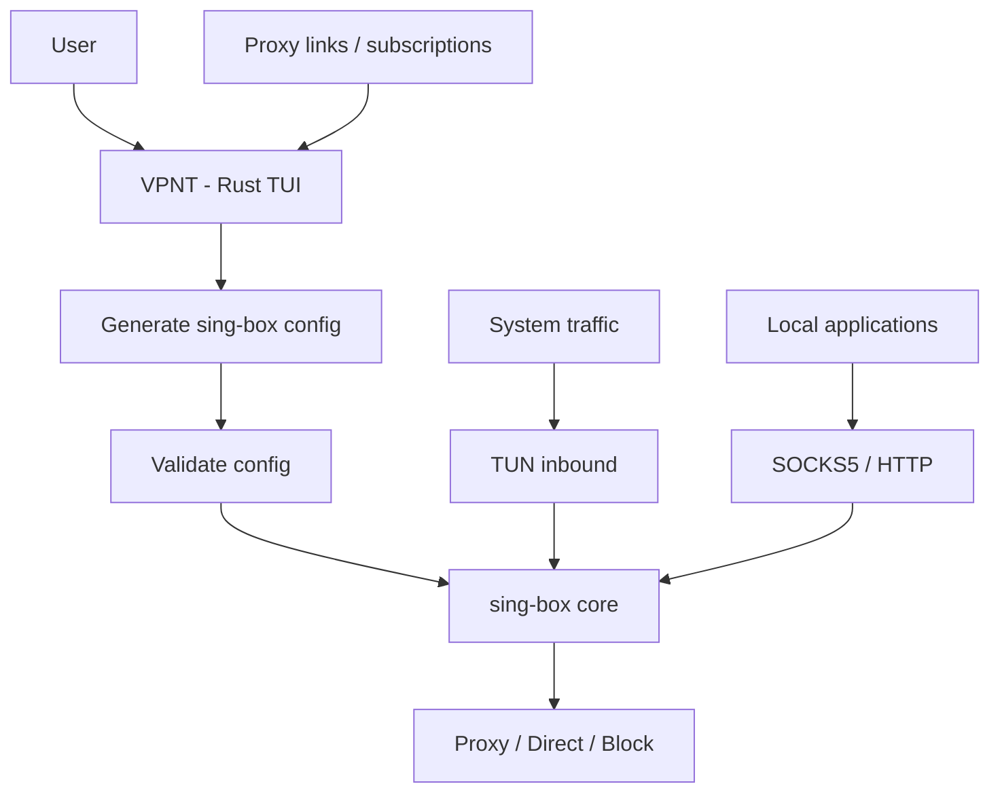

# vpnt

<div align="center">

[](LICENSE)
[](https://www.rust-lang.org/)
[](https://github.com/arman2005l/vpnt)

</div>

A personal terminal UI (TUI) VPN client for Linux. You import proxy share links
(`vless://`, `vmess://`, `trojan://`, `ss://`, `hysteria2://` / `hy2://`, `tuic://`)
or a subscription URL. vpnt then writes a [sing-box](https://sing-box.sagernet.org/)
config and runs `sing-box` as a child process in TUN mode. vpnt does not
implement any proxy protocol itself.

Only Linux (Ubuntu) is tested. The Windows code paths are stubs.

## Architecture



## Install

```sh
cargo install --path .
```

### sing-box requirement

vpnt needs a `sing-box` binary. It looks first for `sing-box` inside the data
directory and then on `PATH`. Install sing-box from its release page or your
package manager.

TUN mode needs network capabilities. vpnt never calls `sudo`. Grant them to the
binary once (and again after every sing-box upgrade):

```sh
sudo setcap cap_net_admin,cap_net_bind_service,cap_net_raw+ep $(which sing-box)
```

Before each start, vpnt runs `sing-box check -c` on the generated config and
shows any error in the status bar.

The generated config is self-contained: it uses no geoip/geosite rule-sets and
downloads nothing at startup, so it works when GitHub is unreachable. Private
IPs and local names (`localhost`, `.local`, `.lan`, `.internal`, `.home.arpa`)
always go direct. If sing-box stops during startup, the Dashboard shows
`Error: <last FATAL line>` and the Logs tab has the full output.

## Keys

Press `?` (or `F1`) in the app for this list.

**Global**

| Key | Action |
| --- | --- |
| `Tab` / `Shift-Tab` | Switch tabs |
| `j` `k` / arrows | Move cursor |
| `s` | Connect / disconnect |
| `r` / `R` | Restart the core (`r` refreshes on the Dashboard) |
| `?` / `F1` / `Esc` | Toggle help |
| `q`, `Ctrl-q`, `Ctrl-c` | Quit (disconnects first) |

**Dashboard**: `r` re-measures the exit IP and latency.

**Configs**

| Key | Action |
| --- | --- |
| `a` | Add a share link or raw sing-box outbound JSON (paste works) |
| `i` | Import a subscription URL (base64 or plain list, one link per line) |
| `e` | Rename selected |
| `d` | Delete selected (`y` confirms) |
| `t` | TCP-ping all configs |
| `Enter` | Make selected config active |

**Apps (routing rules)**

| Key | Action |
| --- | --- |
| `a` | Add a rule: app name or domain (`app:` / `domain:` prefix to force) |
| `Enter` / `Space` | Cycle rule action, or add the selected seen app |
| `d` | Delete rule |
| `m` | Toggle default mode (all via VPN / only listed via VPN) |

**Logs** (last 1000 lines of sing-box output)

| Key | Action |
| --- | --- |
| `PageUp` / `PageDown` | Scroll one page |
| `Home` / `End` | Oldest line / newest line and follow |
| `f` | Toggle following the tail |

## Data files

Everything lives in `~/.config/vpnt/` (the `directories` config dir). When vpnt is
started through `sudo`, it uses `/home/$SUDO_USER/.config/vpnt/` instead.

| File | Contents |
| --- | --- |
| `configs.json` | Imported configs (contains secrets) |
| `settings.json` | Active config, ports, log level |
| `rules.json` | Routing rules and default mode |
| `config.json` | Generated sing-box config (contains secrets) |
| `logs/vpnt.log.YYYY-MM-DD` | vpnt's own log, rotated daily |

## License

VPNT is distributed under the [MIT License](LICENSE).

Third-party components retain their respective licenses.
